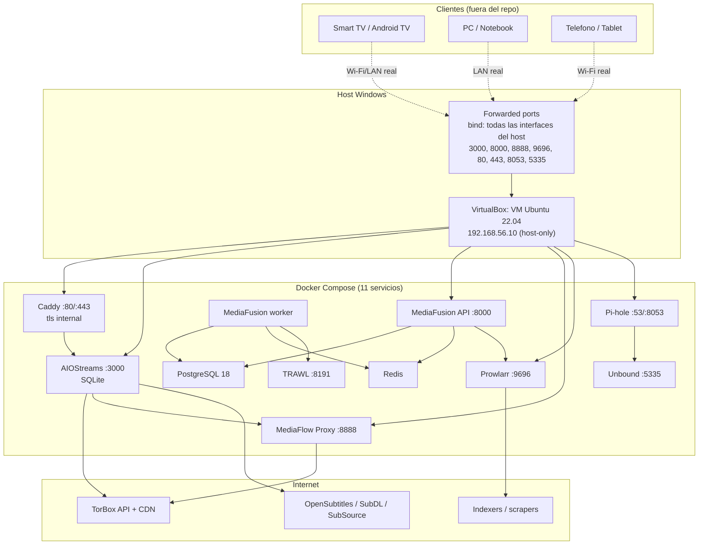
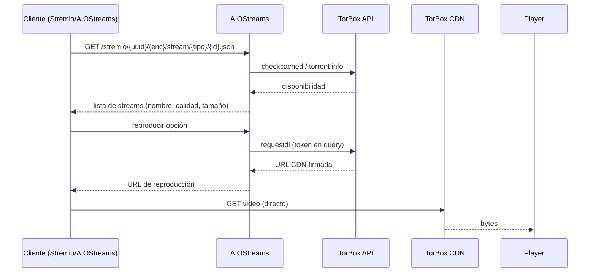
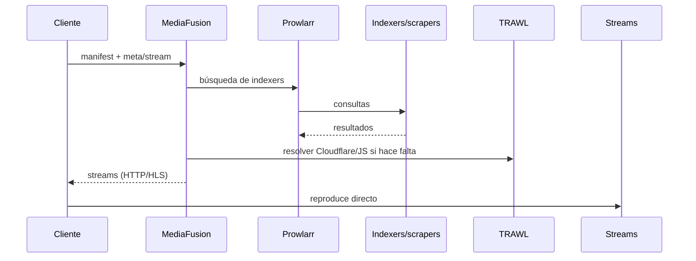
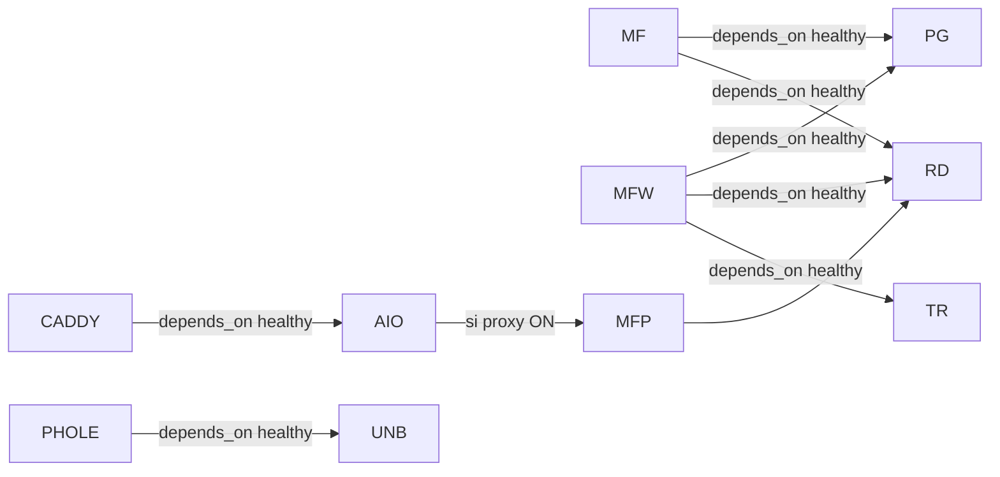
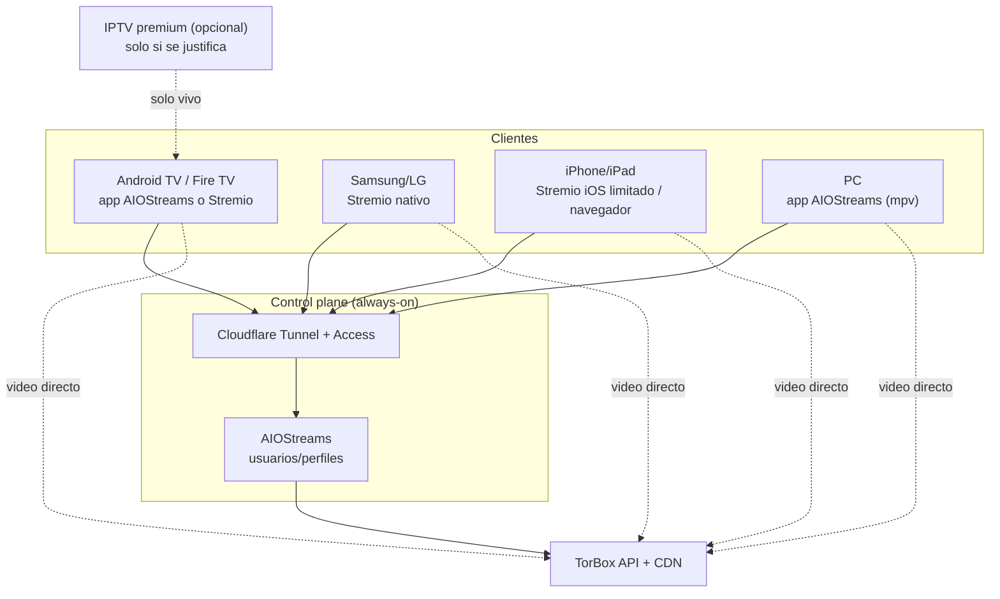

# 02 — Arquitectura

**Estado:** auditoría estática + validación de configuración. No se ejecutó el stack.
**Archivo principal:** `docker-compose.yml` (225 líneas, 11 servicios).

---

## 1. Qué es realmente este repositorio

No es una plataforma de streaming. Es una **composición de imágenes de terceros** más documentación y scripts de bootstrap. No hay código propio de aplicación.

```
15 archivos versionados
├── docker-compose.yml      → 11 servicios
├── setup.sh                → genera .env, data/, Caddyfile
├── .env.example            → plantilla
├── config/Caddyfile        → reverse proxy
├── config/stremio-addons.md
├── docs/{ARCHITECTURE,WIRING,LEGAL,COMO_FUNCIONAN}.md
├── privacy/README.md
├── vm/{Vagrantfile,provision.sh}
└── README.md
```

**Implicación para la auditoría:** no hay frontend, backend, router, componentes, player, tests ni API propia que auditar. Todo lo que el usuario percibe como "la plataforma" es AIOStreams, Stremio, Nuvio, MediaFusion y el player del dispositivo. Cualquier afirmación sobre reproducción, codecs o UX es responsabilidad de esos terceros y debe probarse en el dispositivo real.

---

## 2. Arquitectura actual (como está en el repo)



### Problema central del diagrama

La flecha "TV/PC/Telefono → forwarded ports" **no lleva a las URLs documentadas**:

- `private_network` en VirtualBox es una red **host-only**: solo el host ve `192.168.56.10`.
- Los `forwarded_port` de Vagrant se bindean a **todas las interfaces del host** por defecto (docs oficiales de Vagrant), así que existe un camino por `http://<IP-LAN-del-host>:3000` (sujeto al firewall del host).
- Pero `BASE_URL` y `HOST_URL` están fijados a `192.168.56.10`: los manifests, posters y addons que generan AIOStreams/MediaFusion apuntan a una dirección que ningún otro dispositivo puede resolver.
- El puerto 53 (DNS) no está forwardeado: Pi-hole no recibe consultas de la LAN.
- La TV y los familiares están en la LAN/Wi-Fi real, no en `192.168.56.0/24`.

Resultado: **el host entra; cualquier otro dispositivo recibe URLs hacia una red que no ve, y el DNS no llega a Pi-hole.**

---

## 3. Componentes y responsabilidades

| Servicio | Imagen | Puerto | Rol real | Estado |
|---|---|---|---|---|
| `aiostreams` | `ghcr.io/viren070/aiostreams:latest` | 3000 | Orquestador, proxy de addons, debrid, usuarios | Núcleo correcto; healthcheck roto |
| `mediaflow-proxy` | `mhdzumair/mediaflow-proxy:latest` | 8888 | Proxy HLS/DASH/HTTP, IPTV, headers | Útil para vivo; contraproducente para VOD |
| `caddy` | `caddy:latest` | 80/443 | HTTPS interno + reverse proxy | Roto: `:443` sin hostname |
| `unbound` | `mvance/unbound:latest` | 5335 | DNS recursivo | Roto: bind mount vacío |
| `pihole` | `pihole/pihole:latest` | 53, 8053 | DNS + bloqueo | Roto: env v6 + upstream + puerto 53 |
| `mediafusion-api` | `mhdzumair/mediafusion:6.0.0` | 8000 | Addon de deportes/VOD | Imagen existe; URL HTTP no instalable remoto |
| `mediafusion-worker` | `mhdzumair/mediafusion:6.0.0` | — | Worker de scraping | Correcto según compose oficial |
| `postgres` | `postgres:18-alpine` | 5432 | DB de MediaFusion | Sin `shm_size`, sin tuning |
| `redis` | `redis:latest` | 6379 | Cache/colas | Sin auth, interno |
| `prowlarr` | `ghcr.io/hotio/prowlarr:latest` | 9696 | Indexers | Expuesto HTTP, sin auth por defecto |
| `trawl` | `ghcr.io/germondai/trawl:latest` | 8191 | Browser pool / Cloudflare | Pesado; sin límites |

**Todos los servicios comparten la red default de Compose.** No hay segmentación entre el plano de administración (AIOStreams, Prowlarr, MediaFusion) y el plano de datos (MediaFlow, TorBox).

---

## 4. Flujo de datos esperado

### 4.1 VOD (películas/series)



**Punto clave:** en el camino directo, el video **no pasa por la VM**. AIOStreams solo resuelve el link. Si se activa MediaFlow, el cliente pide el video a MediaFlow, y MediaFlow lo pide a TorBox: ahí sí pasa todo por la VM.

### 4.2 Deportes (MediaFusion)



**Realidad:** los streams de deportes gratuitos son de terceros no autorizados, cambian de dominio y se caen. MediaFusion agrega valor como agregador, pero **no garantiza disponibilidad**. La única ruta "cero downtime" es una lista IPTV premium estable (Vía B), que el repo menciona pero no integra.

### 4.3 Subtítulos

Los subtítulos **no pasan por el servidor**. El cliente (Stremio/AIOStreams) consulta OpenSubtitles/SubDL/SubSource y el addon Subtitle Sync. Es un flujo del lado del cliente, con las credenciales/configuración de cada usuario. No hay nada en el repo que garantice VOSE.

---

## 5. Puntos de falla y dependencias



| Falla | Efecto en cadena |
|---|---|
| Unbound crash-loop | Pi-hole nunca arranca |
| AIOStreams unhealthy | Caddy nunca arranca |
| Postgres no healthy | MediaFusion API y worker no arrancan |
| Redis no healthy | MediaFusion y MediaFlow no arrancan |
| TRAWL no healthy | Worker de MediaFusion no arranca (la API sí) |
| Host apagado | Todo el control plane cae |
| Uplink saturado | Si MediaFlow está ON, todos los streams sufren |

**No hay reintentos acotados, ni circuit breaker, ni fallback.** `restart: unless-stopped` reinicia, pero un crash-loop por configuración no se resuelve solo.

---

## 6. Hallazgos de arquitectura

### ARCH-01 — Las URLs del stack apuntan a una red host-only

| Campo | Valor |
|---|---|
| **ID** | ARCH-01 |
| **Severidad** | **P0** |
| **Categoría** | Arquitectura / Red |
| **Descripción** | `private_network` crea una red host-only: solo el host llega a `192.168.56.10`. `BASE_URL` y `HOST_URL`/`POSTER_HOST_URL` están fijados a esa IP, así que los manifests, posters y URLs que generan AIOStreams/MediaFusion son inalcanzables desde la TV y los telefonos. Los forwarded ports sí se bindean a todas las interfaces del host (docs de Vagrant), pero no compensan las URLs generadas. El puerto 53 no se forwardea. |
| **Evidencia** | `vm/Vagrantfile:5-8`; `.env:1,6,7`; docs de Vagrant sobre private networks y forwarded ports (bind a todas las interfaces). |
| **Esperado** | Las URLs de addon apuntan a una dirección alcanzable desde la LAN (IP LAN del host con bridged o Docker nativo) y el DNS llega a Pi-hole. |
| **Actual** | URLs host-only; la TV no puede instalar el addon; Pi-hole no recibe consultas de la LAN. |
| **Reproducción** | 1) Levantar el stack. 2) Desde otro dispositivo de la LAN: `curl http://192.168.56.10:3000` → timeout. 3) Instalar el manifest con esa IP en Stremio → falla. |
| **Impacto** | El requisito "TV en la misma Wi-Fi" y "2–3 familiares" no se cumple. |
| **Causa raíz** | Se eligió `private_network` (host-only) y se hardcodeó su IP en `.env`, en lugar de usar red bridged o la IP LAN del host. |
| **Fix** | (a) `config.vm.network "public_network"` (bridged) y apuntar `BASE_URL`/`HOST_URL` a la IP que asigna el router; o (b) Docker nativo en el host, publicando en la IP LAN; o (c) mínimo: cambiar `BASE_URL`/`HOST_URL` a `http://<IP-LAN-del-host>:...` (los forwarded ports ya escuchan en todas las interfaces) y forwardear 53. |
| **Esfuerzo** | S (1–2 h) |
| **Dependencias** | Definir si se usa VM o Docker nativo. |
| **Test que valida** | Desde una TV/telefono en la LAN: abrir la UI de AIOStreams, instalar el manifest y reproducir un título. |
| **Estado** | **CONFIRMADO** (semántica de Vagrant/VirtualBox y `.env`; no ejecutado por falta de VirtualBox). |

---

### ARCH-02 — MediaFlow convierte la VM en relay de todo el video

| Campo | Valor |
|---|---|
| **ID** | ARCH-02 |
| **Severidad** | **P1** |
| **Categoría** | Arquitectura / Performance |
| **Descripción** | El README indica seleccionar MediaFlow como proxy en AIOStreams. Si se aplica a todos los streams, el video entra y sale por la VM: se duplica el ancho de banda y la VM pasa a ser cuello de botella y SPOF. |
| **Evidencia** | `README.md:114-122`; `docs/ARCHITECTURE.md:13`; `docker-compose.yml:27-47`. |
| **Esperado** | VOD directo desde TorBox CDN; MediaFlow solo para vivo/IPTV que requiera headers. |
| **Actual** | MediaFlow se presenta como "reduce latencia y evita bloqueos", sin aclarar que centraliza el tráfico. |
| **Reproducción** | Activar MediaFlow en AIOStreams; reproducir 4K; medir `docker stats` y tráfico de la VM; comparar con proxy off. |
| **Impacto** | 3 streams 4K (~25 Mbps c/u) = ~75 Mbps de bajada + subida. Un uplink hogareño típico no lo soporta. |
| **Causa raíz** | Se confundió "proxy de streams" con "mejor ruta"; para VOD el CDN directo suele ser mejor. |
| **Fix** | No usar MediaFlow para VOD. Si se usa, aplicarlo solo a addons de vivo y monitorear. |
| **Esfuerzo** | S (config) |
| **Dependencias** | Entender el modelo de proxies de AIOStreams (por addon/servicio). |
| **Test que valida** | Reproducir el mismo título con proxy on/off; comparar latencia, buffering y tráfico. |
| **Estado** | **CONFIRMADO** por arquitectura; falta medición. |

---

### ARCH-03 — No hay application layer propio

| Campo | Valor |
|---|---|
| **ID** | ARCH-03 |
| **Severidad** | **P2** |
| **Categoría** | Arquitectura / Producto |
| **Descripción** | No hay frontend, backend, player, perfiles, enlaces de compartir ni auth propia. Todo se delega a terceros. |
| **Evidencia** | `git ls-files` (15 archivos, ninguno de código); `docker-compose.yml` (solo imágenes). |
| **Esperado** | (Según el brief) plataforma propia con enlaces por contenido, player, continue watching. |
| **Actual** | AIOStreams/Stremio hacen eso, no el repo. |
| **Impacto** | El brief y la implementación no coinciden. Cualquier feature "propia" exige construirla o configurar la de AIOStreams. |
| **Causa raíz** | Se asumió que el compose era la plataforma. |
| **Fix** | Decidir: (a) usar AIOStreams v2 como producto (recomendado), o (b) construir una capa propia (no recomendado para 3 usuarios). |
| **Esfuerzo** | S (decisión) / XL (si se construye) |
| **Dependencias** | Producto. |
| **Test que valida** | N/A. |
| **Estado** | **CONFIRMADO**. |

---

### ARCH-04 — El control plane no es always-on

| Campo | Valor |
|---|---|
| **ID** | ARCH-04 |
| **Severidad** | **P1** |
| **Categoría** | Arquitectura / Disponibilidad |
| **Descripción** | AIOStreams, Caddy y MediaFusion corren en una VM en una PC de escritorio. Si el host se apaga, duerme o se reinicia, los familiares no pueden resolver contenido nuevo. |
| **Evidencia** | `vm/Vagrantfile` (VM local); no hay VPS/NAS/HA; `README.md` no documenta uptime. |
| **Esperado** | Control plane disponible cuando la familia quiere ver algo. |
| **Actual** | Depende de que la PC esté encendida. |
| **Impacto** | "No anda" cada vez que el host duerme. |
| **Causa raíz** | Se eligió una VM local para un servicio familiar. |
| **Fix** | Host 24/7 con suspensión deshabilitada, NAS, o VPS pequeño solo para AIOStreams (el video sigue directo desde TorBox). |
| **Esfuerzo** | M (infra) |
| **Dependencias** | Presupuesto, consumo eléctrico, IP pública/túnel. |
| **Test que valida** | Apagar el host y verificar que un familiar no puede abrir la app; luego mover a VPS y repetir. |
| **Estado** | **CONFIRMADO** por diseño. |

---

### Bloque OPS — Operación

### OPS-01 — `vagrant up` no encuentra `docker-compose.yml`

| Campo | Valor |
|---|---|
| **ID** | OPS-01 |
| **Severidad** | **P0** |
| **Categoría** | Bootstrap / Vagrant |
| **Descripción** | No hay `synced_folder` explícito: Vagrant monta el directorio del `Vagrantfile` (es decir, `vm/`) en `/vagrant`. `provision.sh` copia `/vagrant` a `/opt/media/fubol` y ejecuta `docker compose up -d` ahí. Ese directorio contiene `Vagrantfile` y `provision.sh`, no `docker-compose.yml` ni `setup.sh`. El provision termina con error y `set -euo pipefail` corta el proceso. |
| **Evidencia** | `vm/Vagrantfile:14` (sin `synced_folder`); `vm/provision.sh:19-25`; `vm/provision.sh:23` (`cd /opt/media/fubol` tiene éxito, así que nunca cae a `/vagrant`). |
| **Esperado** | `vagrant up` provisiona y deja el stack corriendo. |
| **Actual** | `docker compose up -d` falla porque no hay archivo de compose en `/opt/media/fubol`; el `setup.sh` previo también falla pero está silenciado con `2>/dev/null || true`. |
| **Reproducción** | 1) `cd vm`. 2) `vagrant up`. 3) Ver el error de provision en la salida / `vagrant provision`. 4) `vagrant ssh -c 'ls /opt/media/fubol'` → solo `Vagrantfile` y `provision.sh`. |
| **Impacto** | El flujo de instalación documentado no termina; el stack no arranca. |
| **Causa raíz** | Se asumió que `/vagrant` apunta a la raíz del repo; el `Vagrantfile` está dentro de `vm/`. |
| **Fix** | `config.vm.synced_folder "..", "/vagrant"` en `vm/Vagrantfile`, y que `provision.sh` verifique la existencia de `/vagrant/docker-compose.yml` antes de continuar (fallar ruidosamente). Alternativa: mover el `Vagrantfile` a la raíz. |
| **Esfuerzo** | S (1 h) |
| **Dependencias** | Decisión VM vs. Docker nativo (Etapa A1). |
| **Test que valida** | `vagrant ssh -c 'ls -l /vagrant/docker-compose.yml && docker compose ps'` sin errores. |
| **Estado** | **CONFIRMADO** por configuración; no ejecutado (sin Vagrant/VirtualBox en este entorno). |

---

### OPS-02 — Caddy con `:443` + `tls internal` no emite certificado

| Campo | Valor |
|---|---|
| **ID** | OPS-02 |
| **Severidad** | **P0** |
| **Categoría** | TLS / Reverse proxy |
| **Descripción** | El site block es `:443` catch-all sin hostname. Caddy no sabe qué certificado emitir para un nombre desconocido y no lo entrega; el handshake TLS falla. Reemplazarlo por `https://<IP-o-dominio>` sí emite, pero con la CA local de Caddy (no confiada por TV/telefonos). |
| **Evidencia** | `config/Caddyfile:2-5`; prueba real con Caddy 2.11.7 (T-08 en `07_TEST_RESULTS.md`): catch-all → `SEC_E_ILLEGAL_MESSAGE`; `https://192.168.56.10` → `certificate obtained successfully` (issuer `local`). |
| **Esperado** | HTTPS válido que la TV y los familiares puedan usar para instalar addons. |
| **Actual** | Sin certificado para el catch-all; con hostname, certificado no confiado. |
| **Reproducción** | 1) `caddy run --config config/Caddyfile`. 2) `curl -vk https://127.0.0.1/` → error de handshake y ningún `certificate obtained` en los logs. |
| **Impacto** | Caddy queda inutilizable; los clientes no pueden instalar addons por HTTPS. |
| **Causa raíz** | Se confundió un catch-all con un site block con hostname; `tls internal` no sirve para terceros. |
| **Fix** | Cloudflare Tunnel/Let's Encrypt con dominio real (Etapa A5). Para LAN pura, `https://<IP>` + instalar la CA de Caddy en cada dispositivo (no escala). |
| **Esfuerzo** | S–M (2–4 h) |
| **Dependencias** | Dominio o túnel. |
| **Test que valida** | `curl -I https://<host>` sin `-k` → 200; instalar el addon en la TV. |
| **Estado** | **CONFIRMADO** con prueba real (Caddy 2.11.7 en Windows; misma semántica en Linux). |

---

### OPS-03 — Unbound monta un directorio vacío y entra en crash-loop

| Campo | Valor |
|---|---|
| **ID** | OPS-03 |
| **Severidad** | **P0** |
| **Categoría** | DNS / Contenedores |
| **Descripción** | El volumen `./data/unbound:/opt/unbound/etc/unbound` tapa los archivos que trae la imagen (`a-records.conf`, `srv-records.conf`, `forward-records.conf`). `unbound.conf` los incluye; si no existen, Unbound no arranca. `setup.sh` crea `data/unbound` vacío. El contenedor entra en crash-loop y, por `depends_on: service_healthy`, Pi-hole nunca arranca. |
| **Evidencia** | `docker-compose.yml:74`; `setup.sh:40`; documentación/código del entrypoint de `mvance/unbound` (`unbound.sh`, includes obligatorios) — verificado en T-13. |
| **Esperado** | Unbound arranca `healthy`; Pi-hole arranca después. |
| **Actual** | Crash-loop de Unbound; Pi-hole en `Created`. |
| **Reproducción** | 1) `bash setup.sh`. 2) `docker compose up -d`. 3) `docker compose ps` → unbound reiniciando. 4) `docker logs unbound` → `cannot open include file`. |
| **Impacto** | Se cae la cadena DNS completa (Unbound + Pi-hole). |
| **Causa raíz** | Se montó un directorio vacío sobre un path de configuración que la imagen espera poblado. |
| **Fix** | (a) Recomendado: quitar Unbound de la v1. (b) Crear `unbound.conf` recursivo real y los tres includes (aunque estén vacíos) en `data/unbound/`, o montar solo `unbound.conf` como archivo. |
| **Esfuerzo** | S (2–4 h) |
| **Dependencias** | Decisión de mantener DNS propio. |
| **Test que valida** | `docker compose ps unbound` → `healthy`; `docker logs unbound` sin errores de include; `dig @<IP> google.com` responde. |
| **Estado** | **CONFIRMADO** por documentación/código upstream y configuración; no ejecutado (sin Docker). |

---

### OPS-04 — El healthcheck de AIOStreams apunta a una ruta inexistente

| Campo | Valor |
|---|---|
| **ID** | OPS-04 |
| **Severidad** | **P0** |
| **Categoría** | Orquestación / Healthchecks |
| **Descripción** | El healthcheck usa `http://localhost:3000/health`. AIOStreams expone `/api/v1/health` y `/api/v1/status`; su propio healthcheck usa `/api/v1/status`. `/health` devuelve 404, el contenedor queda `unhealthy` y, por `depends_on: condition: service_healthy`, **Caddy nunca arranca**. |
| **Evidencia** | `docker-compose.yml:21`; `docker-compose.yml:60-62`; rutas y `scripts/healthcheck.js` de AIOStreams (T-10). |
| **Esperado** | AIOStreams `healthy`; Caddy arranca. |
| **Actual** | AIOStreams `unhealthy` en cada intervalo; Caddy en `Created`. |
| **Reproducción** | 1) `docker compose up -d`. 2) `docker inspect --format '{{.State.Health.Status}}' aiostreams` → `unhealthy`. 3) `docker compose ps caddy` → no `Up`. |
| **Impacto** | Sin Caddy no hay HTTPS ni el flujo documentado; el resto del stack puede quedar arriba, pero el acceso anunciado no existe. |
| **Causa raíz** | Se inventó `/health` en lugar de usar la ruta real. |
| **Fix** | `test: ["CMD", "wget", "-qO-", "http://localhost:3000/api/v1/status"]` (o quitar el override y usar el healthcheck de la imagen). |
| **Esfuerzo** | XS (15 min) |
| **Dependencias** | Ninguna. |
| **Test que valida** | `docker inspect` → `healthy`; `docker compose ps caddy` → `Up`. |
| **Estado** | **CONFIRMADO** por código upstream de AIOStreams. |

---

### OPS-05 — Upstream de Pi-hole apunta al puerto equivocado

| Campo | Valor |
|---|---|
| **ID** | OPS-05 |
| **Severidad** | **P1** |
| **Categoría** | DNS / Configuración |
| **Descripción** | El README indica `unbound#5335`. Dentro de la red de Docker, el contenedor `unbound` escucha en el puerto **53**; el `5335` es solo el puerto publicado en el host. Docker no reescribe puertos entre contenedores. |
| **Evidencia** | `README.md:187`; `docs/WIRING.md:22`; `privacy/README.md:25`; `docker-compose.yml:76-77`. |
| **Esperado** | Pi-hole resuelve contra `unbound#53`. |
| **Actual** | Intenta `unbound#5335` → conexión rechazada; cae al DNS por defecto o falla. |
| **Reproducción** | `docker compose exec pihole dig @unbound -p 5335 google.com` → timeout; `dig @unbound google.com` → responde. |
| **Impacto** | La privacidad DNS prometida no funciona. |
| **Causa raíz** | Se confundió puerto publicado con puerto del servicio. |
| **Fix** | Usar `unbound#53` en Pi-hole. |
| **Esfuerzo** | XS |
| **Dependencias** | OPS-03. |
| **Test que valida** | `dig @<IP-Pi-hole> google.com` responde y los logs muestran consultas a unbound. |
| **Estado** | **CONFIRMADO** por semántica de redes Docker. |

---

### OPS-06 — Conflicto del puerto 53 con systemd-resolved

| Campo | Valor |
|---|---|
| **ID** | OPS-06 |
| **Severidad** | **P1** |
| **Categoría** | DNS / SO |
| **Descripción** | En Ubuntu 22.04, `systemd-resolved` escucha en `127.0.0.53:53`. Docker publica Pi-hole en `0.0.0.0:53`; el bind puede fallar con "address already in use". El provision no deshabilita el stub. |
| **Evidencia** | `docker-compose.yml:88-91`; `vm/provision.sh` no toca systemd-resolved. |
| **Esperado** | Pi-hole escucha en 53 sin conflicto. |
| **Actual** | Posible fallo de arranque del contenedor o DNS inconsistente. |
| **Reproducción** | En la VM: `ss -lunpt \| grep :53` y `docker compose up pihole`. |
| **Impacto** | Pi-hole no arranca o el host resuelve por systemd-resolved. |
| **Causa raíz** | No se liberó el puerto antes de publicar. |
| **Fix** | `DNSStubListener=no` en `/etc/systemd/resolved.conf` + `systemctl restart systemd-resolved`; o no publicar 53 en el host. |
| **Esfuerzo** | S |
| **Dependencias** | A2/A6. |
| **Test que valida** | `systemd-resolve --status` sin stub en 53; `dig @<IP> google.com` funciona. |
| **Estado** | **RIESGO FUNDAMENTADO**; no ejecutado en VM. |

---

### OPS-07 — Solo AIOStreams está detrás de Caddy

| Campo | Valor |
|---|---|
| **ID** | OPS-07 |
| **Severidad** | **P1** |
| **Categoría** | Exposición |
| **Descripción** | Caddy solo proxea `aiostreams:3000`. MediaFusion, MediaFlow y Prowlarr quedan expuestos por HTTP directo, sin TLS ni auth centralizada. |
| **Evidencia** | `config/Caddyfile:4`; `docker-compose.yml` puertos 8000, 8888, 9696. |
| **Esperado** | Todas las UIs detrás de un proxy único con auth o red interna. |
| **Actual** | Puertos administrativos abiertos. |
| **Reproducción** | `curl -I http://<IP>:9696` y `http://<IP>:8000` desde otro dispositivo. |
| **Impacto** | Superficie de ataque ampliada; si se expone el túnel, dashboards públicos. |
| **Causa raíz** | Caddy se agregó solo para AIOStreams. |
| **Fix** | No publicar 8888/9696/8000 al host; acceder por túnel/SSH o por Caddy con auth. |
| **Esfuerzo** | S |
| **Dependencias** | A7. |
| **Test que valida** | Escaneo de puertos desde otro dispositivo: solo 80/443 (o el túnel). |
| **Estado** | **CONFIRMADO** por configuración. |

---

### OPS-08 — Imágenes `latest` sin digests

| Campo | Valor |
|---|---|
| **ID** | OPS-08 |
| **Severidad** | **P1** |
| **Categoría** | Cadena de suministro / Reproducibilidad |
| **Descripción** | 8 de 11 servicios usan `latest`. Un `docker compose pull` puede traer cambios incompatibles. Pi-hole v5→v6 ya rompió la config. |
| **Evidencia** | `docker-compose.yml:5,28,50,70,85,177,190,210`. |
| **Esperado** | Versiones fijas o digests, con actualización controlada. |
| **Actual** | `latest` en la mayoría. |
| **Impacto** | Caídas aleatorias tras un pull/reboot; dificultad para reproducir. |
| **Causa raíz** | Se priorizó "siempre lo último". |
| **Fix** | Pinnear versiones (empezar por Pi-hole, Caddy, AIOStreams); documentar el procedimiento de upgrade. |
| **Esfuerzo** | S–M |
| **Dependencias** | Ninguna. |
| **Test que valida** | `docker compose config` muestra tags fijos; un upgrade en rama no rompe el smoke test. |
| **Estado** | **CONFIRMADO**. |

---

### OPS-09 — Sin límites de logs ni de recursos

| Campo | Valor |
|---|---|
| **ID** | OPS-09 |
| **Severidad** | **P1** |
| **Categoría** | Operación / Capacidad |
| **Descripción** | Ningún servicio define `logging` ni `deploy.resources`. En una VM de 8 GB con TRAWL, Postgres, Redis, MediaFusion y el resto, los logs pueden llenar el disco y la memoria puede agotarse. |
| **Evidencia** | `docker-compose.yml` (sin `logging`/`limits`); `vm/Vagrantfile:11` (8 GB). |
| **Esperado** | Rotación de logs y límites por servicio. |
| **Actual** | Crecimiento sin control. |
| **Impacto** | Disco lleno → caída total; OOM kill de Postgres/MediaFusion. |
| **Fix** | `logging: max-size: 10m, max-file: 3`; límites de memoria/CPU; monitoreo de disco y RAM. |
| **Esfuerzo** | S |
| **Dependencias** | C3. |
| **Test que valida** | `docker inspect` muestra log opts; 7 días sin llenar disco. |
| **Estado** | **RIESGO FUNDAMENTADO**. |

---

### OPS-10 — Sin backups automáticos ni restore probado

| Campo | Valor |
|---|---|
| **ID** | OPS-10 |
| **Severidad** | **P1** |
| **Categoría** | Continuidad |
| **Descripción** | No hay backup programado. El README menciona un `tar` manual. Los datos incluyen SQLite de AIOStreams, Postgres, Prowlarr y Pi-hole. |
| **Evidencia** | `README.md:256-258` (comando manual); no hay cron/servicio de backup. |
| **Esperado** | Backup diario con retención y restore probado. |
| **Actual** | Manual y no probado. |
| **Impacto** | Pérdida de configuración/credenciales ante falla de disco. |
| **Fix** | Script + cron/Task Scheduler; copia a otro disco/nube cifrada; probar restore. |
| **Esfuerzo** | S–M |
| **Dependencias** | C3. |
| **Test que valida** | Borrar `data/` en una copia y restaurar; el stack arranca igual. |
| **Estado** | **CONFIRMADO** por ausencia. |

---

### Hallazgos menores de operación

| ID | Sev. | Descripción | Evidencia | Fix | Estado |
|---|---|---|---|---|---|
| OPS-11 | P2 | El healthcheck de MediaFlow usa `curl`, que no está en la imagen runtime (`python:3.14-slim`). El contenedor queda `unhealthy` siempre. | `docker-compose.yml:43`; Dockerfile de MediaFlow | Usar `python -c "import urllib.request; ..."` o instalar curl | **CONFIRMADO** |
| OPS-12 | P2 | Prowlarr se publica en `:9696` sin auth configurada explícitamente. | `docker-compose.yml:190-207` | Activar Forms auth y no exponer el puerto | **RIESGO FUNDAMENTADO** |
| OPS-13 | P3 | `version: "3.9"` obsoleto; Compose lo ignora y advierte. | `docker-compose.yml:1`; test T-04 | Eliminar la clave | **CONFIRMADO** |
| OPS-14 | P3 | Postgres sin `shm_size` (el compose oficial usa 512 MB). | `docker-compose.yml:159-174` | Agregar `shm_size: 512mb` | **RIESGO FUNDAMENTADO** |
| OPS-15 | P3 | `provision.sh` duerme 30 s en vez de `docker compose up -d --wait`. | `vm/provision.sh:25-29` | Usar `--wait` y verificar health | **CONFIRMADO** |
| OPS-16 | P3 | `container_name` impide escalar; aceptable para este caso. | `docker-compose.yml` (todos) | Dejar como está o quitar si se escala | **CONFIRMADO** |
| OPS-17 | P3 | `DATABASE_URI` duplicado en `.env` y en compose. | `docker-compose.yml:16`; `.env:3` | Dejar una sola fuente | **CONFIRMADO** |

---

## 7. Alternativas de despliegue (A–E)

| Opción | Qué es | Costo | Latencia | Privacidad | Complejidad | Familiar |
|---|---|---|---|---|---|---|
| **A. LAN only (actual, corregido)** | VM en la PC, solo misma red | Bajo | Baja | Alta | Media | No (sin remote) |
| **B. LAN + Cloudflare Tunnel + Access** | VM local expuesta por túnel | Dominio (~USD 10/año) | Media | Cloudflare ve metadata | Media | **Alta** |
| **C. LAN + Tailscale** | VPN mesh | Gratis (plan free) | Baja | Alta | Media | Baja (instalar app) |
| **D. VPS control plane + TorBox directo** | AIOStreams en VPS; video directo | USD 5–10/mes | Baja | Media | Media | **Alta** |
| **E. Managed (ElfHosted/AIOStreams)** | Tercero hospeda | Suscripción | Baja | Baja | Baja | Alta |

### Recomendación

- **Corto plazo ( Etapa A):** corregir A para LAN, sin pretender remote.
- **Etapa B:** **B** (Cloudflare Tunnel + Access) si se acepta Cloudflare; **C** si se prefiere no exponer nada y los familiares pueden instalar Tailscale.
- **Si el host no puede estar 24/7:** **D** (VPS solo para AIOStreams; el video no pasa por el VPS).
- **E** es la opción de menor esfuerzo, pero la menos privada y con costo recurrente.

---

## 8. Arquitectura recomendada (mínima y verificable)



**Qué se saca de la v1:** MediaFusion, worker, Postgres, Redis, Prowlarr, TRAWL, MediaFlow, Pi-hole, Unbound. **Qué se mantiene:** AIOStreams, TorBox, Caddy/túnel, un cliente por dispositivo.

**Por qué:** cada servicio extra es una dependencia, un healthcheck, un volumen, un secreto y una forma de fallar. Para 3 usuarios, el valor marginal de MediaFusion/Prowlarr/TRAWL no compensa el costo operativo, sobre todo cuando los streams gratuitos no son confiables.

---

## 9. Respuestas de arquitectura

- **¿Dónde corre cada cosa?** Todo en una VM local, salvo el video (TorBox CDN) y los scrapers. No hay separación de planos.
- **¿Qué pasa si se cae un servicio?** Ver tabla de la sección 5. Los `depends_on` convierten fallas locales en fallas en cadena.
- **¿Qué pasa si cambia la IP?** `BASE_URL` y `HOST_URL` están hardcodeados a `192.168.56.10`; cualquier cambio de red rompe manifests y posters.
- **¿Qué pasa si se llena el disco?** No hay límites de logs ni de cache; `data/aiostreams` puede crecer con cache de Usenet, y los logs de Docker no rotan.
- **¿Qué pasa si TorBox falla?** AIOStreams no tiene fallback a otro debrid; los streams propios de MediaFusion pueden seguir, pero la calidad es otra.
- **¿Qué pasa si el indexer falla?** MediaFusion devuelve menos resultados; no hay degradación elegante documentada.

---

## 10. Conclusión

La arquitectura **no está lista para el objetivo**. El núcleo AIOStreams + TorBox es la única parte que vale la pena conservar tal cual. El resto es una suma de servicios que no se probaron juntos, con una red que no llega a la TV, un TLS que no funciona y un control plane que no es always-on.

La arquitectura recomendada es **mucho más chica**: AIOStreams + TorBox + un túnel + un cliente por dispositivo. Eso reduce el riesgo, el mantenimiento y el costo, y es lo único que se puede prometer con honestidad para 2–3 familiares.
