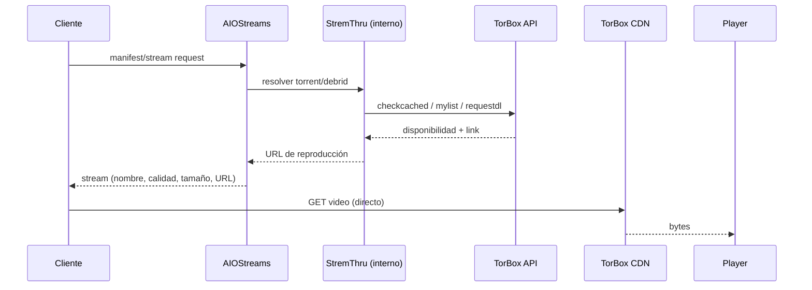
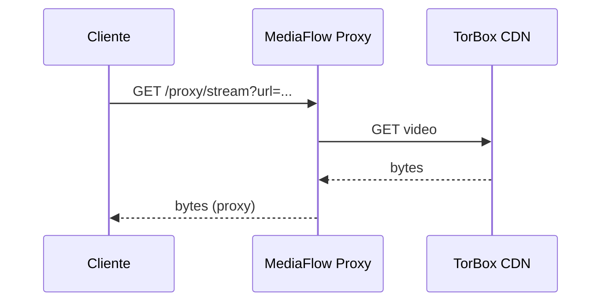

# 04 — Streaming y TorBox

**Alcance:** arquitectura de reproducción, integración real con TorBox, tipos de enlace, expiración, cacheo, concurrencia, codecs y límites del player.
**Estado:** análisis de código/fuente oficial. **No se ejecutó playback ni se llamó a la API autenticada de TorBox** (no hay API key ni Docker en este entorno).

---

## 1. Cómo se reproduce, en concreto

### Camino actual (VOD)

**El video no pasa por AIOStreams.** AIOStreams solo resuelve el enlace; el player baja del CDN de TorBox. Ese es el diseño correcto para no consumir ancho de banda del servidor.

### Con MediaFlow activado

Ahí **sí** pasa todo por la VM: bajada + subida, CPU, y un solo punto de falla. Para VOD es contraproducente; para vivo con headers/Cloudflare puede tener sentido.

---

## 2. Contrato real de la API de TorBox

> Fuente: documentación oficial `api-docs.torbox.app` y SDK `TorBox-App/torbox-sdk-js` (octubre 2026).

| Aspecto | Dato verificado |
|---|---|
| Base URL | `https://api.torbox.app/v1/api` |
| Auth general | `Authorization: Bearer <API_KEY>` |
| Auth en `requestdl` | Parámetro `token=<API_KEY>` en el query string |
| `checkcached` | Hasta **100 hashes** por llamada; resultado cacheado **1 hora** |
| `mylist` | La lista se actualiza cada **600 segundos**; `bypass_cache=true` fuerza refresco |
| `requestdl` | El link queda abierto **3 horas para *iniciar*** la descarga; una vez iniciada, el tiempo es casi ilimitado |
| Permalinks | `requestdl?token=<API_KEY>...&redirect=true` genera una URL que **incluye la API key**; no compartir |
| Rate limit | 429 si se excede; no hay número público estable |
| Planes | Free 1 slot, Essential 3, Standard 5, Pro 10 descargas activas |
| Cached | Los ítems cacheados **no consumen slot** |
| Abuso | Umbrales de tráfico mensual (10/20/30 TB según plan; verificar en la cuenta) |
| Cuenta compartida | TorBox **permite** compartir cuenta y API key; no hay límite de dispositivos |
| SLA | No hay garantía de disponibilidad; el contenido puede caer por DMCA |

### Los cuatro tipos de enlace (no confundirlos)

| Tipo | Qué contiene | ¿Se puede dar a un familiar? |
|---|---|---|
| **API key** | Credencial maestra de la cuenta | **Nunca** |
| **Signed CDN URL** | Token temporal del CDN, sin API key | **Sí**, pero expira |
| **Permalink** | `token=<API_KEY>` en la URL | **Nunca** |
| **MediaFlow URL** | URL del proxy, posiblemente con password/parámetros cifrados | **Depende**; si incluye `api_password`, no |

**Riesgo:** si AIOStreams o MediaFlow generan un permalink de TorBox y lo devuelven al cliente, la API key queda en el player y en cualquier log. AIOStreams tiene `makeUrlLogSafe`, pero **no se probó el camino completo** con una cuenta real.

---

## 3. Integración real en este repo

### Lo que hay

- **No hay `TORBOX_API_KEY`** en `.env`, `docker-compose.yml` ni en el repo.
- La key se ingresa manualmente en el dashboard de AIOStreams (`README.md:104-110`, `docs/WIRING.md:6-10`).
- AIOStreams usa el SDK de TorBox y StremThru para resolver torrents; el camino de Usenet usa `requestdl` con `redirect:false` y devuelve el link del CDN.
- MediaFusion tiene integración opcional con TorBox (`docs/WIRING.md:18`), pero **no está configurada**.
- No hay tests, mocks ni una llamada de humo a la API.

### Lo que no hay

- Verificación de que la key funciona.
- Manejo de errores de plan/slots/rate limit en la UI.
- Rotación/revocación.
- Medición de cuánto tráfico consume cada usuario.
- Un fallback a otro debrid si TorBox falla.

**Conclusión:** la integración es **delegada y no verificada**. El repo no puede afirmar que el streaming funciona; solo que AIOStreams debería hacerlo.

---

## 4. Hallazgos

### STR-01 — Manifest URL con formato viejo (AIOStreams v2)

| Campo | Valor |
|---|---|
| **ID** | STR-01 |
| **Severidad** | **P1** |
| **Categoría** | Integración / Documentación |
| **Descripción** | El README indica `http://<IP>:3000/stremio/<TOKEN>/manifest.json`. AIOStreams v2 espera `/stremio/<uuid>/<encryptedPassword>/manifest.json`. Con el formato viejo, el segundo segmento se interpreta como password y la autenticación falla. |
| **Evidencia** | `README.md:129,136`; rutas de AIOStreams (`/stremio/:uuid/:encryptedPassword/manifest.json`); el healthcheck oficial usa `/api/v1/status`. |
| **Esperado** | Copiar la URL exacta que genera "Save & Install" (uuid + password cifrada). |
| **Actual** | URL de una sola pieza, inválida para v2. |
| **Reproducción** | Instalar la URL del README en Stremio → error de addon / 401. |
| **Impacto** | El usuario no puede instalar el addon; concluye que "no funciona". |
| **Causa raíz** | Documentación de v1 aplicada a v2. |
| **Fix** | Documentar el formato v2 y no inventar tokens; usar el botón "Copy manifest URL" de la UI. |
| **Esfuerzo** | XS |
| **Dependencias** | Ninguna. |
| **Test que valida** | `curl -sS '<manifest-url>' | jq .id` → JSON válido; instalar en Stremio y ver streams. |
| **Estado** | **CONFIRMADO** por código de AIOStreams. |

---

### STR-02 — MediaFusion no es instalable desde fuera de localhost

| Campo | Valor |
|---|---|
| **ID** | STR-02 |
| **Severidad** | **P1** |
| **Categoría** | Integración / Red |
| **Descripción** | `HOST_URL` y `POSTER_HOST_URL` son `http://192.168.56.10:8000`. Caddy solo proxea AIOStreams; no hay ruta HTTPS para MediaFusion. Stremio exige HTTPS para addons que no sean localhost. |
| **Evidencia** | `.env:6-7`; `config/Caddyfile:2-5`; `README.md` (reconoce que HTTP solo sirve en localhost). |
| **Esperado** | `https://mediafusion.<dominio>` con TLS válido y `HOST_URL` igual a esa URL. |
| **Actual** | HTTP + IP host-only. |
| **Reproducción** | Instalar `http://192.168.56.10:8000/manifest.json` en Stremio desde una TV/telefono → falla. |
| **Impacto** | El addon de deportes no se puede usar en dispositivos reales; solo en el host. |
| **Causa raíz** | Se agregó MediaFusion sin plan de exposición TLS. |
| **Fix** | Agregar un site block en Caddy para MediaFusion con hostname real, o exponerlo por el mismo túnel; actualizar `HOST_URL`. |
| **Esfuerzo** | S–M |
| **Dependencias** | Dominio/túnel. |
| **Test que valida** | Instalar el manifest desde un telefono fuera de localhost y ver streams. |
| **Estado** | **CONFIRMADO** por configuración. |

---

### STR-03 — MediaFlow como proxy de VOD duplica el tráfico

| Campo | Valor |
|---|---|
| **ID** | STR-03 (= ARCH-02) |
| **Severidad** | **P1** |
| **Categoría** | Performance / Arquitectura |
| **Descripción** | Si se activa MediaFlow para todos los streams, el video pasa por la VM: se duplica el ancho de banda y la VM se vuelve cuello de botella. El README lo recomienda sin aclarar el costo. |
| **Evidencia** | `README.md:114-122`; `docs/ARCHITECTURE.md:13`; `docker-compose.yml:27-47`. |
| **Esperado** | VOD directo; proxy solo para vivo/IPTV. |
| **Actual** | Proxy global. |
| **Impacto** | Buffering con 2–3 streams 4K; el uplink del hogar se satura; la VM no da abasto. |
| **Causa raíz** | Se confundió "proxy" con "mejor ruta". |
| **Fix** | Aplicar MediaFlow solo a addons de vivo; monitorear `docker stats` y tráfico. |
| **Esfuerzo** | S |
| **Test que valida** | Mismo título con proxy on/off; medir latencia y buffering. |
| **Estado** | **CONFIRMADO** por arquitectura; falta medición. |

---

### STR-04 — Expiración de links y cache sin TTL configurado

| Campo | Valor |
|---|---|
| **ID** | STR-04 |
| **Severidad** | **P1** |
| **Categoría** | Streaming / Confiabilidad |
| **Descripción** | TorBox abre el link 3 horas para *iniciar*. AIOStreams cachea links de playback, pero el repo no configura TTL ni re-resolución. Si el usuario deja el player en pausa antes de iniciar, o vuelve después de horas, el link puede estar vencido. |
| **Evidencia** | Docs de TorBox (`requestdl`); `packages/core/src/debrid/torbox.ts` (cache de playback, `redirect:false`); no hay variables de TTL en `.env`. |
| **Esperado** | Re-resolver automáticamente si el link expira. |
| **Actual** | Depende del comportamiento interno de AIOStreams, no configurado ni probado. |
| **Reproducción** | Resolver un título, esperar >3 h sin iniciar, intentar reproducir. |
| **Impacto** | Error 403/410 y necesidad de elegir el stream de nuevo. |
| **Causa raíz** | No se modeló el ciclo de vida del link. |
| **Fix** | Verificar la lógica de re-resolución de AIOStreams; documentar "si expira, volvé a elegir el stream"; no cachear links más allá de la ventana de TorBox. |
| **Esfuerzo** | S (documentar) / M (si hay que parchear) |
| **Dependencias** | API key real para probar. |
| **Test que valida** | Reproducir después de la ventana de expiración. |
| **Estado** | **RIESGO FUNDAMENTADO**; no probado. |

---

### STR-05 — Sin control de concurrencia ni de ancho de banda

| Campo | Valor |
|---|---|
| **ID** | STR-05 |
| **Severidad** | **P2** |
| **Categoría** | Operación |
| **Descripción** | No hay límites por usuario, ni alertas de consumo, ni estimación de cuántos streams 4K soporta el uplink. Los slots de TorBox no son el único límite: también el ancho de banda y el CPU si MediaFlow está on. |
| **Evidencia** | No hay variables de límites en `.env`/compose; `README.md:89-90` solo menciona slots. |
| **Esperado** | Presupuesto de ancho de banda y reglas (ej. 1080p para remotos). |
| **Actual** | Todos pueden pedir 4K. |
| **Impacto** | Saturación y buffering para todos. |
| **Fix** | Perfiles con límites de calidad; monitorear; documentar "1 stream 4K o 2–3 en 1080p". |
| **Esfuerzo** | S |
| **Estado** | **CONFIRMADO** por ausencia. |

---

### STR-06 — Sin player propio ni matriz de codecs probada

| Campo | Valor |
|---|---|
| **ID** | STR-06 |
| **Severidad** | **P2** |
| **Categoría** | Compatibilidad |
| **Descripción** | No hay player en el repo. La reproducción depende de Stremio/Nuvio/app de AIOStreams y del dispositivo. No hay una matriz de qué contenedor/codec funciona en cada uno. |
| **Evidencia** | `git ls-files`; docs de AIOStreams: el navegador falla con MKV/HEVC/surround; desktop usa mpv; Android usa ExoPlayer+mpv; TV usa el player del fabricante. |
| **Esperado** | Saber qué formato pedir por dispositivo. |
| **Actual** | Sin guía; el usuario elige a ciegas. |
| **Impacto** | "No se ve" o "se ve sin audio" en TVs/telefonos. |
| **Fix** | Matriz en `05_DEVICE_COMPATIBILITY.md`; preferir 1080p H.264/AAC para browsers y TVs viejas; 4K HEVC solo en clientes compatibles. |
| **Esfuerzo** | S |
| **Estado** | **CONFIRMADO** por ausencia; compatibilidad real **NO VERIFICADA**. |

---

### STR-07 — Sin fallback de debrid ni de fuente

| Campo | Valor |
|---|---|
| **ID** | STR-07 |
| **Severidad** | **P2** |
| **Categoría** | Resiliencia |
| **Descripción** | Si TorBox está caído, rate-limited o sin slots, AIOStreams no tiene un segundo debrid configurado. Tampoco hay fallback a streams P2P (que además traen riesgos legales/privacidad). |
| **Evidencia** | `.env`/compose solo configuran TorBox vía UI; no hay otro servicio. |
| **Esperado** | Degradación elegante o mensaje claro. |
| **Actual** | Error genérico. |
| **Impacto** | La familia ve "no hay streams" sin explicación. |
| **Fix** | Documentar el error; opcionalmente agregar un segundo debrid (costo) o aceptar la caída. |
| **Esfuerzo** | S–M |
| **Estado** | **CONFIRMADO** por ausencia. |

---

## 5. Codecs y contenedores: qué esperar

> Esta tabla combina documentación oficial de AIOStreams/Stremio con limitaciones conocidas de navegadores y TVs. **No se probó en dispositivos físicos.** Ver `05_DEVICE_COMPATIBILITY.md`.

| Formato | Navegador | Desktop (mpv) | Android (ExoPlayer/mpv) | TV Samsung/LG | Notas |
|---|---|---|---|---|---|
| MP4 H.264 + AAC | ✅ | ✅ | ✅ | ✅ | Máxima compatibilidad |
| MKV H.264 + AAC | ❌ (browser) | ✅ | ✅ | ⚠️ depende | El browser no maneja MKV |
| MKV HEVC + AAC | ❌ | ✅ | ⚠️ | ⚠️ | HEVC varía por TV |
| HEVC 10-bit HDR | ❌ | ✅ | ⚠️ | ⚠️ | HDR requiere cadena completa |
| AV1 | ❌ | ✅ (mpv reciente) | ⚠️ | ⚠️ | TVs 2023+ |
| AC3/EAC3 | ❌ | ✅ | ⚠️ | ⚠️ | Sin licencia en algunos navegadores |
| DTS | ❌ | ✅ | ⚠️ | ⚠️ | Frecuente en remux |
| HLS (m3u8) | ✅ | ✅ | ✅ | ✅ | Vivo/IPTV |
| MPEG-TS | ❌ | ✅ | ✅ | ⚠️ | Vivo |

**Regla práctica:** si el cliente es un navegador o una TV sin soporte HEVC, pedir **1080p H.264/AAC**. Si es desktop/Android con mpv, se puede 4K HEVC. MediaFlow tiene transcoding a H.264/AAC, pero **no está activado** y en un VM de 4 CPU no aguanta 3 streams 4K.

---

## 6. Respuestas directas

### ¿La API key queda expuesta al cliente?

**No en el camino normal:** AIOStreams devuelve un link firmado del CDN, no la key. **Riesgo** si se usan permalinks o si los logs capturan la URL de `requestdl` (que lleva `token=`). No se pudo verificar con una cuenta real.

### ¿Qué pasa si el usuario pausa?

Si el stream **ya inició**, el link de TorBox sigue siendo válido casi indefinidamente; pausar/reanudar no debería cortar. Si el usuario **no inició** y deja el player en pausa >3 h, el link puede expirar. Si el cliente vuelve a pedir el stream, AIOStreams debería re-resolver; no está probado.

### ¿Cuántos pueden ver a la vez?

Depende de tres límites: slots de TorBox (3/5/10 descargas activas; los cacheados no consumen), ancho de banda del host/uplink, y CPU si MediaFlow transcodea. Para 3 familiares, **Essential alcanza para cached**, pero no hay margen para 3 uncached simultáneos.

### ¿Se puede compartir un link de una película?

**No con este repo.** AIOStreams comparte una manifest (todo el addon), no un contenido. Un link directo de TorBox expira y no es seguro. Ver SEC-05.

### ¿Qué pasa si TorBox cambia la API?

AIOStreams se rompe hasta que se actualice la imagen. Como usa `latest`, un `docker compose pull` puede traer el fix o una regresión. No hay pin ni rollback documentado.

### ¿Qué pasa con los subtítulos?

No pasan por el servidor. El cliente los busca en OpenSubtitles/SubDL/SubSource o en el addon Subtitle Sync. La sincronización depende del addon y de la pista de audio; no hay garantía VOSE. AIOStreams v2 tiene sync incorporado en su app, que es la mejor opción.

---

## 7. Veredicto de streaming

**4/10.** La elección TorBox + AIOStreams es la parte más sólida del proyecto. Pero:
- la manifest está mal documentada,
- no hay una prueba real de playback,
- el proxy puede arruinar la performance,
- no hay control de concurrencia ni de expiración,
- y el player/codecs no están mapeados.

**Lo que sí se puede prometer:** VOD vía TorBox + AIOStreams, en LAN, con un cliente compatible, después de corregir la manifest y el TLS.
**Lo que no se puede prometer:** deportes gratuitos estables, 4K para 3 personas a la vez, ni enlaces por contenido.
